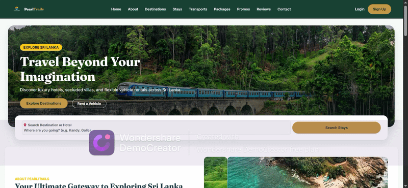

# 🌿 PearlTrails – Web-Based Tourism & Travel Management Platform

PearlTrails is a full-stack web-based Tourism and Travel Management System developed to simplify and streamline travel planning, accommodation reservations, transportation bookings, and curated tour package management across Sri Lanka.

The platform connects tourists with local service providers through a centralized system, offering a convenient and efficient travel management experience.

---

## 🎬 Project Demo



---

## 📋 Table of Contents

- [Overview](#-overview)
- [Key Features](#-key-features)
- [Technology Stack](#-technology-stack)
- [Design Patterns](#-design-patterns)
- [System Architecture](#-system-architecture--folder-structure)
- [Installation & Setup Guide](#-installation--setup-guide)
- [Default Test Credentials](#-default-test-credentials)
- [Team Members](#-team-members)
- [Academic Information](#-academic-information)

---

## 📖 Overview

The Sri Lankan tourism industry requires an integrated digital platform that connects tourists with accommodation providers, transportation services, and travel agents.

**PearlTrails** provides a centralized platform where tourists can explore and book accommodations, transportation services, and travel packages. Service providers can manage their listings and reservations, while administrators can monitor platform activities, manage users, moderate content, and generate system reports.

The system aims to improve the efficiency, accessibility, and convenience of tourism-related services.

---

## 🚀 Key Features

### 👤 Tourist Module

- **Explore & Search:** Browse available accommodations, transportation services, and travel packages.
- **Seamless Booking:** Book hotels, villas, transportation services, and curated travel packages.
- **Secure Checkout:** Complete booking checkout and payment processes.
- **Promotional Discounts:** Apply promotional codes to receive discounts.
- **Ratings & Reviews:** Submit reviews and ratings based on experiences.
- **Booking Management:** View and manage personal bookings.

### 🏨 Service Provider Module

- **Listing Management:** Create, update, and manage accommodation listings.
- **Transportation Management:** Add and manage available transportation services.
- **Package Management:** Create and manage travel packages.
- **Reservation Tracking:** View and manage customer bookings.
- **Booking Management:** Track accommodation, package, and transportation reservations.

### 🛡️ System Administrator Module

- **Admin Dashboard:** Monitor registered users, listings, travel packages, and transportation services.
- **User Management:** View registered users and block or reactivate accounts.
- **Listing Moderation:** Manage and moderate accommodation listings.
- **Review Management:** Approve, reject, and manage customer reviews.
- **Promo Code Management:** Create, update, and delete promotional codes.
- **System Reports:** Generate administrative reports and review platform activities.

---

## 🛠️ Technology Stack

| Category | Technologies |
|---|---|
| Backend | Java, Spring Boot |
| Frontend | JSP, HTML5, CSS3, JavaScript |
| Database | MySQL |
| Build Tool | Maven |
| Development IDE | IntelliJ IDEA |
| Version Control | Git & GitHub |

---

## 🧩 Design Patterns

The project implements several object-oriented design patterns to improve code organization, maintainability, and reusability.

- **Singleton Pattern:** `DatabaseConnectionManager`
- **Factory Pattern:** `HotelRoomFactory`
- **Strategy Pattern:** `PaymentStrategy`, `PaymentContext`
- **Decorator Pattern:** `TourGuideDecorator`
- **Observer Pattern:** `TransportBookingSubject`

---

## 📂 System Architecture & Folder Structure

The application follows a layered architecture using Spring Boot and the MVC design approach.

```text
tourism-travel-management-system/
│
├── src/
│   ├── main/
│   │   ├── java/
│   │   │   └── com/pearltrails/pearltrails/
│   │   │       ├── controller/
│   │   │       ├── model/
│   │   │       ├── repository/
│   │   │       ├── service/
│   │   │       └── pattern/
│   │   │
│   │   ├── resources/
│   │   │   └── application.properties
│   │   │
│   │   └── webapp/
│   │       ├── WEB-INF/
│   │       │   └── jsp/
│   │       └── images/
│   │
│   └── test/
│
├── .mvn/
├── mvnw
├── mvnw.cmd
├── pom.xml
└── README.md
```

### Main Components

- **Controller:** Handles HTTP requests and application navigation.
- **Model:** Represents application entities and data structures.
- **Repository:** Handles database operations.
- **Service:** Contains application business logic.
- **Pattern:** Contains implementations of the applied design patterns.
- **JSP:** Provides the user interface and dynamic web pages.

---

## ⚙️ Installation & Setup Guide

### 1. Clone the Repository

```bash
git clone https://github.com/IT25103864/tourism-travel-management-system.git
```

Navigate into the project directory:

```bash
cd tourism-travel-management-system
```

### 2. Prerequisites

Make sure the following software is installed:

- Java JDK (compatible with the project configuration)
- IntelliJ IDEA
- MySQL Server
- Maven (optional, since the project includes Maven Wrapper)

### 3. Database Setup

- Start your MySQL server.
- Create a database named `pearltrails_db`.
- Import the project's database schema and required data if an SQL script is provided.

### 4. Configure Application Properties

Open:

`src/main/resources/application.properties`

Configure your local database connection details:

```properties
spring.datasource.url=jdbc:mysql://localhost:3306/pearltrails_db
spring.datasource.username=root
spring.datasource.password=YOUR_PASSWORD
```

Update the credentials according to your local MySQL configuration.

**Important:** Do not commit real database passwords, API keys, or other sensitive information to GitHub.

### 5. Build the Project

Using Maven:

```bash
mvn clean install
```

Or using the Maven Wrapper on Windows:

```powershell
.\mvnw.cmd clean install
```

### 6. Run the Application

Run the main Spring Boot application class:

`PearltrailsApplication.java`

Alternatively, use:

```bash
mvn spring-boot:run
```

### 7. Access the Application

Once the application starts successfully:

- **Main Portal:** `http://localhost:8081/`
- **Admin Dashboard:** `http://localhost:8081/admin`

The server port may vary depending on your application configuration.

---

## 🔐 Default Test Credentials

Test credentials should be configured locally for development and demonstration purposes.

For security reasons, actual account passwords and private login credentials are not published in this repository.

---

## 👥 Team Members

**Group ID:** 26-MTR-SE2030-16

| Student ID | Member Name | Assigned Module / Role |
|---|---|---|
| IT25103864 | Gunasekara B.A. | Admin Dashboard, Reports, Promo Codes & System Integration |
| IT25103899 | Dilasha J.A. | User Authentication, Checkout and Payment Management |
| IT25103402 | Bethmika B.J. | Hotel & Villa Listing Management |
| IT25103040 | Jayasooriya G.V. | Transport & Vehicle Rental Management |
| IT25102254 | Ammaar M.A. | Travel Packages & Booking Management |

---

## 🎓 Academic Information

- **Course Module:** SE2030 – Software Engineering
- **Institution:** Sri Lanka Institute of Information Technology (SLIIT)
- **Academic Year:** Year 2, Semester 1 (2026)

---

## 📄 License

This project was developed for academic purposes as part of the SE2030 Software Engineering module.
